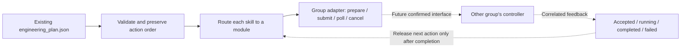

# Controller dispatch framework（控制指令分发框架）

This module is the boundary between **our engineering plan** and **the controllers owned by other groups**, such as navigation. It prepares traceable requests, defines adapter methods and exercises serial feedback handling offline. The current implementation does not connect to a robot.



Solid links are offline request preparation. Dashed links await real adapter integration. Synthetic feedback exercises the same intended lifecycle without claiming a controller response.

## What is implemented

- Input: the existing `real_robot_proposal_envelope_v1` engineering JSON. No new LLM output format is required.
- All **33 catalogue skill IDs** have explicit routes in `controller_routes.json`.
- Five logical slots: `navigation`, `locomotion`, `whole_body`, `manipulation`, `perception`. These are proposed module boundaries; actual group ownership must be confirmed.
- Existing action arguments and order are preserved, including repeated actions. Subtask dependencies and existing derived action indexes are checked. No extra path planning, coordinate guessing, action insertion or motion-parameter tuning is performed.
- Stable command IDs bind each request to the exact source-file SHA-256 and step ID. Original action IDs, graph/edge hashes, coordinate-frame information and precondition checks are retained. Missing scene information remains unknown.
- Unknown skills/routes, malformed arguments, empty steps, unresolved subtasks, invalid dependencies and stale action indexes are rejected.
- The adapter protocol declares preparation, submission, feedback polling and cancellation. Real adapters are explicit placeholders.
- An offline runner demonstrates acknowledgement, progress, completion, failure, cancellation and unknown outcomes. All its results are marked `mode: simulation`, `robot_executed: false` and `memory_committed: false`.

This is a dispatch framework, not a new scheduler for task planning. It follows the plan's existing serial sequence. Parallel/bimanual low-level coordination belongs inside the appropriate group controller or a future explicitly designed coordinator.

## Files

| File | Purpose |
| --- | --- |
| `controller_dispatch.py` | Engineering JSON reader, request compiler, adapter protocol, pending slots and simulation lifecycle |
| `controller_routes.json` | Skill-to-module routes, known navigation fields and missing interface information |
| `../tests/test_controller_dispatch.py` | Offline contract, source-preservation and failure-handling tests |
| `ros2_client.py`, `tcp_client.py` | Existing navigation clients; this framework does not instantiate them |
| `navigation_contract.py` | Existing single-navigation conversion reused by the navigation preview slot when explicitly configured |

## Internal request format

This is **our proposed internal envelope**. It is not asserted to be the wire format accepted by another group.

```json
{
  "schema_version": "controller_command_v1",
  "command_id": "program-generated UUID",
  "source_plan_sha256": "SHA-256 of the exact engineering JSON file",
  "source_action_id": "original program action ID, or null for a legacy input",
  "source_step_id": "st_001_01",
  "module_id": "navigation",
  "skill_id": "navigate_to_object",
  "skill_arguments": {
    "target": {"role_id": "role_001", "element_id": 179},
    "standoff_m": 0.6
  },
  "scene_context": {
    "coordinate_frame": "copied from the source",
    "unit": "metre",
    "source_graph_sha256": "copied from the source",
    "source_edges_sha256": "copied from the source"
  },
  "depends_on": [],
  "controller_payload": null,
  "execution_authorized": false
}
```

The illustrative `standoff_m` is copied from an existing plan, not a new motion default or a generated navigation coordinate. Object IDs identify scene objects; a group adapter still needs a verified runtime mapping. A bounding-box centre is not automatically the robot's stopping pose.

`task_id`, `scene_id`, subtask dependencies, ordinal and source precondition checks are also preserved in actual compiled requests. The preview keeps the original envelope's status and `required_before_dispatch` requirements; compilation does not turn an ungraded proposal into an executable plan.

## The group adapter contract

| Method | Responsibility |
| --- | --- |
| `prepare(command, binding)` | Validate supplied runtime data and translate symbolic arguments into the group's payload. Must not send a command. Return a pending reason if fields or capability evidence are missing. |
| `submit(command, prepared)` | Future integration: send the prepared request once and retain a correlation identifier and raw response. An accepted request is not successful execution. |
| `poll(command_id)` | Future integration: obtain a correlated observation or `None` if no new feedback exists. |
| `cancel(command_id)` | Future integration: request cancellation. A cancellation acknowledgement is not proof that the robot has physically stopped. |

The supplied `PendingGroupAdapter` can report requirements; its send/poll/cancel methods raise `NotImplementedError`. `NavigationAdapterSlot` can call the existing single-navigation **offline converter**, verify that its plan hash and action ID match, and expose the unmodified prepared goal. It still reports `interface_pending` because the new generic dispatcher is not wired to the existing ROS2/TCP clients.

If a navigation replay configuration is available, `--runtime-bindings` accepts a JSON object keyed by the command IDs shown in the preview:

```json
{
  "command-ID-from-preview": {
    "navigation_replay_config": {
      "schema_version": "single_navigation_replay_v1"
    }
  }
}
```

That fragment shows nesting only. Supply the **complete existing replay configuration** required by `navigation_contract.prepare`, including its hashes, map references, poses, parameters and confirmations. This converter currently accepts exactly one navigation action; multi-action runtime pose binding remains a separate integration requirement. A payload preview never sends a goal.

## Feedback and serial progression

Feedback carries `command_id`, `module_id`, `status` and provenance. In the offline runner, every event also has `mode: simulation`; timestamps are recorded in UTC.

| Status | Meaning and next step |
| --- | --- |
| `accepted` | Request accepted; wait for further feedback. |
| `running` | Still executing; do not release the next action. |
| `succeeded` | Completion reported; the next serial action may be considered. In this version the evidence is synthetic only. |
| `failed`, `rejected`, `cancelled` | Stop the remaining sequence and retain the failed prefix. |
| `cancel_requested` | Cancellation requested; wait for a terminal result. |
| `unknown` | Outcome cannot be established, for example after transport loss. Stop; do not automatically resend. |

The state machine rejects mismatched action/module feedback and stale terminal events. Desired effects in a plan are never copied into observed robot state. The offline runner does not update pipeline memory.

The simulation state is in memory, with its final trace saved to disk. **It is not a durable live execution journal and cannot safely resume physical commands after a restart.** Production integration must reuse/extend the established navigation reservation and feedback mechanisms and add equivalent guarantees for the other controllers. Stable IDs alone do not guarantee exactly-once physical execution.

## Try the framework without connecting to the robot

From the project root, using a Python environment that can import this project:

```text
python -m embodied_pipeline dispatch-preview --engineering-plan outputs/real_scene_runs/d3_619_plan_20261022_132214_282023/engineering_plan.json --out outputs/controller_dispatch_demo --simulate
```

The command writes:

- `dispatch_preview.json`: original source references, per-action routing and pending interface information.
- `simulation_trace.json`: synthetic acknowledgement/progress/completion events, when `--simulate` is supplied.

Omit `--simulate` for request preview only. The output directory must be new. This command has no live mode, needs no API key or ROS2 installation, and makes no WSL or robot connection.

## Information needed from the other groups

| Needed item | Example / reason |
| --- | --- |
| Actual module owner and supported skills | Confirm who owns grasping, arm motion, whole-body reset, etc.; logical routes are currently proposals. |
| Transport, endpoint, interface version | ROS2 Action/Service, TCP protocol or Python API. Navigation already has `/nav/navigate_to`; do not assume every controller uses it. |
| Exact request fields, types, units, required/default values | Map our symbolic arguments without inventing poses, limits or controller settings. |
| Runtime geometry/state source | Object pose, hand selection, current robot pose, scene-to-robot transforms and calibrated reset references. |
| Acceptance, progress and completion feedback | Identify the actual fields that establish arrival or manipulation completion. |
| Error, timeout, cancellation and reconnect semantics | Distinguish rejection, failure and unknown outcome; determine how an in-flight command is reconciled. |
| Capability and validation evidence | Platform, hands, sensors, contact feedback and the checks required before the controller may run. |

Once these are supplied, implement an adapter for that group's payload and feedback, test it against recorded responses, and explicitly integrate it with the existing live execution/UI authorization flow. The current framework does not enable live sending from the field console or replace its navigation controls.
